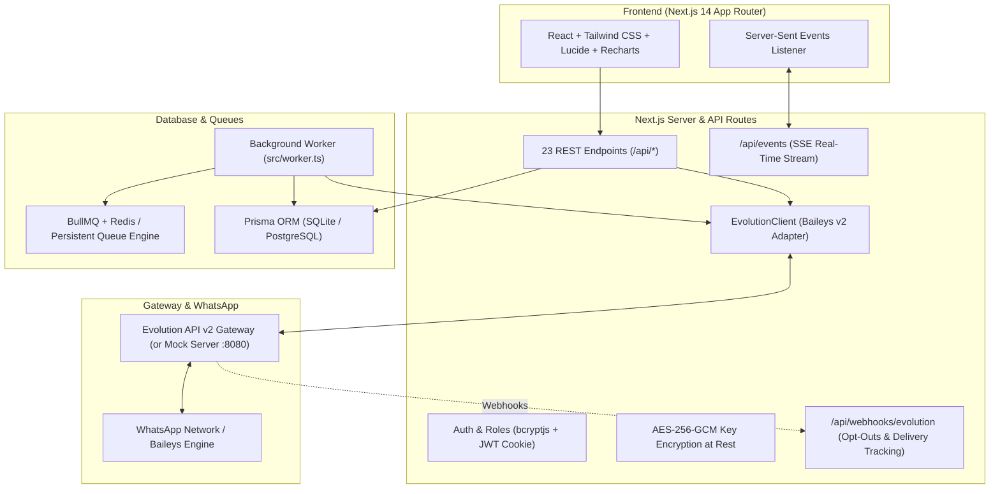

# WhatsApp Campaign Manager (Self-Hosted, Evolution API v2)

A production-grade, self-hosted web application for running consent-based WhatsApp bulk messaging campaigns powered directly by **Evolution API v2 (Baileys WhatsApp Web engine)**. Built with Next.js 14+ (App Router, TypeScript), Prisma (SQLite/PostgreSQL), BullMQ, and Tailwind CSS.

---

## 🏗️ Architecture Diagram



---

## 🌟 Key Features

### 1. Evolution API Connection Manager
- **Settings Screen:** Encrypted storage of `EVOLUTION_API_URL` and `GLOBAL_API_KEY` (AES-256-GCM). "Test Connection" button.
- **Instances Page:** List instances, create new Baileys instances, live state badges (`OPEN`, `CONNECTING`, `CLOSE`), restart, logout, delete.
- **Live QR Modal:** Auto-refreshes connection state every 3s and celebrates connection once scanned via WhatsApp Web Linked Devices.
- **Webhook Auto-Setup:** Automatically registers webhook on `/api/webhooks/evolution` for `CONNECTION_UPDATE`, `MESSAGES_UPDATE`, and `MESSAGES_UPSERT`.
- **Multi-Instance Rotation Pool:** Assign multiple WhatsApp numbers per campaign with `ROUND_ROBIN` or `LEAST_USED` load balancing.

### 2. Contacts, Lists & Ingestion
- **Persistent Contact Database:** Names, phones, custom fields (JSON), tags, opt-in status.
- **Import:** Drag-and-drop CSV / XLSX and paste from clipboard with interactive Column Mapper.
- **Cleaning & Validation:** Normalizes phone numbers with `libphonenumber-js`, removes spaces/dashes, prepends country code (`91`), deduplicates.
- **WhatsApp Existence Check:** Pre-flight validation via `POST /chat/whatsappNumbers/:instance` to skip dead numbers and preserve account reputation.
- **Lists & Segments:** Named lists, list merging.
- **Global Blacklist / Do-Not-Contact:** Automatically populated on opt-out or manual import, strictly excluded from all campaigns.

### 3. Message Composer & Personalization
- **Formatting Toolbar:** `*bold*`, `_italic_`, `~strike~`, ```` ```mono``` ````.
- **Variable Chips & Fallbacks:** `{name}`, `{phone}`, `{company}` with fallback syntax `{name|Valued Customer}`.
- **Spintax Engine:** Nested spintax `{Hi|Hello|Dear}`, with instant shuffle preview and **variation counter** (*e.g. "12 unique variants"*).
- **Live WhatsApp Chat Bubble Preview:** Accurate device mockup previewing formatted bubbles, timestamps, and blue checkmarks.
- **Media Support:** Text, Image, Video, Document (PDF), Audio dispatches via `POST /message/sendMedia/:instance`.
- **Test Send:** Send test message to a single number before launching.

### 4. Safe Pacing, Anti-Ban Engine & Circuit Breaker
- **Pacing Control:** Minimum and maximum delays (default 12–25s) with per-job randomized jitter.
- **Batch Breaks:** Pauses for a cooldown (default 3–8 minutes) after every N messages (default 20–40).
- **Daily Send Cap:** Daily instance quota (default 200) with automatic reset tracking.
- **Sending Window:** Timezone-aware allowed hours (e.g. 09:00–20:00). Auto-pauses outside window.
- **Human Typing Presence:** Simulates `presence: "composing"` 2s before dispatch.
- **Risk Meter:** Computed safety score with plain-language warnings.
- **Emergency Circuit-Breaker:** Automatically pauses campaign if session disconnects, 401/403 errors occur, or consecutive failures reach threshold (default 3).

### 5. Replies Inbox, Auto Opt-Out & Delivery Tracking
- **Delivery Receipts:** Tracks `SENT` &rarr; `DELIVERED` &rarr; `READ` per message via webhooks.
- **In-App Replies Inbox:** Conversation thread view per contact, manual reply sending via API.
- **Auto Opt-Out:** Incoming messages matching `STOP`, `UNSUBSCRIBE`, `CANCEL`, `NO`, or `RUKO` automatically blacklist the contact, cancel pending queued messages, and send confirmation.

### 6. Live Dashboard & Reporting
- **Home Analytics:** Instance health, daily quota gauges, active campaigns, and 7-day trend area charts (Recharts).
- **Real-Time Live Campaign View:** Server-Sent Events (SSE) progress bar (Total, Sent, Delivered, Read, Failed, Replied, Pending, Jitter countdown), real-time log table, filterable recipients table.
- **Export Reports:** One-click CSV and XLSX export (`recipient,phone,status,sent_at,delivered_at,read_at,replied,variant,instance,error`). Export "failed only" and "non-responders".

### 7. Compliance & Safety
- **Opt-In Confirmation:** Requires mandatory confirmation checkbox before launch with recorded timestamp in campaign record.
- **Audit Log:** Comprehensive tracking of who launched, paused, or deleted campaigns and instances.

---

## 🚀 Quick Start Guide

### 1. Prerequisites
- Node.js v20+ or v24+
- (Optional) Redis (included in Docker compose; local fallback supported)

### 2. Local Development Setup

```bash
# 1. Install dependencies
npm install

# 2. Setup SQLite database & seed default Admin
npx prisma db push
npm run db:seed

# 3. Start Mock Evolution API Server (Optional - for local testing without real WhatsApp)
npm run mock:evolution

# 4. In a new terminal, start the Next.js Application
npm run dev

# 5. In a new terminal, start the Background Campaign Worker
npm run worker
```

Open **`http://localhost:3000`** in your browser.

- **Default Administrator Credentials:**
  - **Email:** `admin@example.com`
  - **Password:** `Admin@123`

---

## 🧪 Testing with the Mock Evolution API

The app comes with a built-in mock Evolution API server (`npm run mock:evolution`) running on port `8080`.
- Includes a pre-connected mock instance: `primary-marketing`
- Automatically generates pairing QR codes and simulates connection
- Automatically simulates delivery receipts (`DELIVERY_ACK`) via webhooks
- Simulates WhatsApp number verification (numbers ending in `00` simulate non-WhatsApp numbers)

---

## 🐳 Docker & Dokploy Deployment

### Deploying via Dokploy (Recommended)

Dokploy makes self-hosting this app seamless:

#### Method 1: Dokploy Compose (Full Stack)
1. In Dokploy, click **Create Application** &rarr; select **Compose**.
2. Connect your Git repository: `https://github.com/Paramveer0000/WhatsApp-Web-BM`.
3. Choose branch `main` (or `feature/whatsapp-web-bulk`).
4. In the **Environment** tab, set:
   ```env
   APP_SECRET=your-32-char-random-aes-secret!
   JWT_SECRET=your-secure-jwt-signing-key!
   EVOLUTION_API_URL=https://your-evolution-api.example.com
   ```
5. In **Domains**, map your domain to service `app` on port `3000`.
6. Click **Deploy**. Dokploy will start the web dashboard (`app`), BullMQ worker (`worker`), and `redis`. Database tables and the default admin user are auto-seeded on first boot via `docker-entrypoint.sh`.

#### Method 2: Dokploy Application (Single Container)
1. In Dokploy, create an **Application** pointing to this repository with **Dockerfile**.
2. Create a Dokploy **Redis** service and copy its connection string to `REDIS_URL`.
3. Deploy!

---

## 🐳 Docker Compose Deployment (Local / VPS)

Run the complete stack (App, Background Worker, Redis, and optionally Evolution API):

```bash
docker-compose up -d
```

---

## ⚙️ Environment Variables

| Variable | Default | Description |
|---|---|---|
| `DATABASE_URL` | `file:./dev.db` | SQLite or PostgreSQL connection string |
| `APP_SECRET` | - | 32-character AES-256-GCM encryption secret |
| `JWT_SECRET` | - | Secret key used to sign session cookies |
| `REDIS_URL` | `redis://127.0.0.1:6379` | Redis connection URL for BullMQ queue worker |
| `EVOLUTION_API_URL` | `http://localhost:8080` | Evolution API v2 gateway URL |
| `GLOBAL_API_KEY` | - | Evolution API global authentication key |
| `WEBHOOK_SECRET` | `whsec-evolution-shared-secret` | Shared secret for Evolution API webhook calls |

---

## 🧪 Running Unit Tests

Run the Vitest test suite covering phone normalization, spintax rendering, pacing jitter, risk meter, deduplication, and AES-256-GCM encryption:

```bash
npm test
```
All 11 tests run and pass cleanly.
