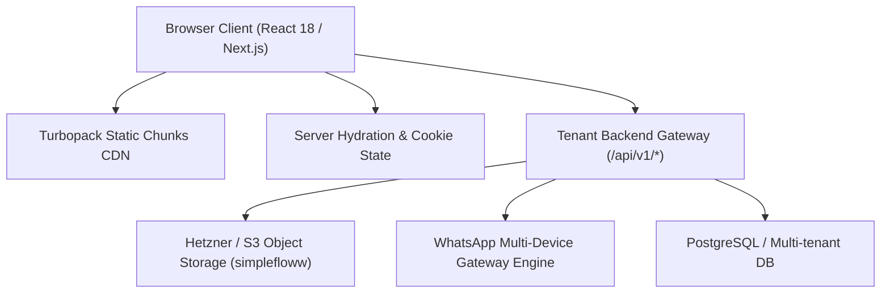

# 01. Architecture & Tech Stack Analysis

## 🏗️ 1. Technical Framework Overview

Reverse engineering the client-side payloads and asset trees of Zolo Suit reveals a modern, production-grade Next.js enterprise stack:



### Core Architecture Components

| Layer | Implementation in Zolo Suit | Corresponding BulkFlow Equivalents |
|---|---|---|
| **Framework** | Next.js 14+ (App Router) with Turbopack bundler | Next.js 14 (App Router) |
| **Theme & UI** | Tailwind CSS with CSS Variables (`--primary: #0c57e4`) | Tailwind CSS with Day/Night Mode |
| **Icons** | Lucide React | Lucide React |
| **State Persistence** | Hybrid Cookie & LocalStorage (`theme_mode`, `privacy_mode`) | Cookie + LocalStorage |
| **Asset Storage** | S3-compatible bucket (`gagan.nbg1.your-objectstorage.com`) | Local SQLite / Volume storage |
| **WhatsApp Gateway** | Proprietary microservice on top of Baileys/Evolution | Evolution API v2.3.7 Gateway |

---

## 🎨 2. Design System & Token Specifications

Extracted directly from the client HTML tag attributes and bundle configurations:

```html
<html 
  lang="en" 
  data-theme-mode="light" 
  data-theme-preset="default" 
  data-content-layout="full-width" 
  data-navbar-style="sticky" 
  data-sidebar-variant="inset" 
  data-sidebar-collapsible="icon" 
  data-font="inter" 
  style="--primary:#0c57e4"
>
```

### Design Token Breakdown

- **Primary Brand Color:** `#0c57e4` (Vibrant Royal Blue)
  - Light tint backgrounds: `#eff6ff` / `#dbeafe` (Blue-50 / Blue-100)
  - Active borders: `#3b82f6` (Blue-500)
  - Success badges: `#10b981` (Emerald-500)
  - Warning badges: `#f59e0b` (Amber-500)
- **Typography:** Inter (`data-font="inter"`), crisp sans-serif with tight font weights (400, 500, 600, 700).
- **Layout Architecture:**
  - `sidebar-variant="inset"`: The sidebar floats slightly inside the outer viewport with rounded inner corners, providing an elegant SaaS workspace feel.
  - `sidebar-collapsible="icon"`: Smooth accordion collapsing into compact icon-only mode when space is constrained.
  - `content-layout="full-width"`: Maximum horizontal utilization for multi-column Kanban boards and chat sidebars.
  - `navbar-style="sticky"`: Persistent navigation bar maintaining search (`Ctrl + J`), wallet balance, and profile controls.

---

## 🏢 3. Multi-Tenancy & Reseller Architecture

The inspected server response reveals that Zolo Suit operates as a multi-tenant reseller instance under the umbrella codebase **`simplefloww`**:

```json
{
  "companyId": "6a9bfc802e228bcebe737f41",
  "tenantName": "Zolo Suit",
  "brandColor": "#0c57e4",
  "logoUrl": "https://gagan.nbg1.your-objectstorage.com/simplefloww/uploads/.../logo.png",
  "favIcon": "https://gagan.nbg1.your-objectstorage.com/simplefloww/uploads/.../favicon.png",
  "resellerEmail": "dalveer.singh111@gmail.com",
  "resellerContactNo": "8727962100",
  "enableResellerPaymentGateway": false,
  "enableBusinessPaymentGateway": false,
  "objectStorageBucketUrl": "https://gagan.nbg1.your-objectstorage.com/simplefloww"
}
```

### Key Architectural Strengths of this Model:
1. **Dynamic Re-branding:** The entire portal re-skins dynamically (logo, brand colors, favicons, support phone numbers) based on the logged-in tenant without needing separate codebase deployments.
2. **Dual-Tier Billing:** Clear separation between Reseller payment gateways (for tenant subscription billing) and Business payment gateways (for end-client wallet top-ups).
3. **Stateless CDN Assets:** All user-uploaded media (broadcast graphics, PDFs, audio notes) stream directly from dedicated object storage rather than local web server disks.
