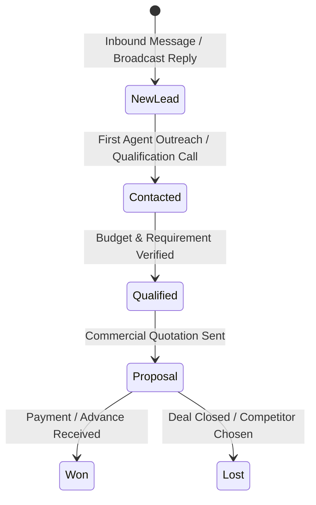

# 03. CRM, Lead Pipeline & Task Management Architecture

## 🎯 1. The Sales Lead Pipeline (`/business/crm/pipeline`)

Zolo Suit bridges the gap between outbound broadcast campaigns and inbound sales conversion via an interactive Kanban board:



### Kanban Stage Specification:

1. **NEW_LEAD (Stage 1):**
   - Automatically populated when a new prospect texts a campaign reply, scans a website QR code, or submits a lead form.
   - Status badge: Soft Slate / Sky blue.
2. **CONTACTED (Stage 2):**
   - Deal is assigned to an agent or representative; initial follow-up or discovery chat completed.
   - Status badge: Amber / Yellow.
3. **QUALIFIED (Stage 3):**
   - Customer interest, volume requirements, and pricing tier confirmed.
   - Status badge: Purple / Indigo.
4. **PROPOSAL (Stage 4):**
   - Formal commercial quotation, warmup schedule, or discount coupon dispatched.
   - Status badge: Rose / Orange.
5. **WON (Stage 5):**
   - Payment confirmed via NEFT/UPI/Gateway.
   - Status badge: Emerald Green.

### Card Data Fields & Financial Aggregation:
- **Deal Title:** e.g., "Enterprise Annual License", "50k Outreach Broadcast".
- **Monetary Deal Value:** Tracked in INR (₹) with auto-summing column header totals (e.g., `Stage Value: ₹1,65,000`).
- **One-Click WhatsApp Trigger:** Dedicated green WhatsApp button on every deal card that instantly opens the live chat thread in the Inbox with that prospect.
- **Priority Indicator:** `HIGH` (Red), `MEDIUM` (Amber), `LOW` (Slate).
- **Assigned Representative:** Shows assigned team member or "Unassigned".

---

## 👥 2. Contacts & Custom Segmentation (`/business/crm/contacts`)

A contact in Zolo Suit is a customer record enriched with campaign engagement telemetry:

### Data Schema Attributes:

```typescript
interface ZoloContact {
  id: string;
  phone: string;              // Normalized E.164 without '+'
  name: string | null;
  company?: string | null;
  city?: string | null;
  tags: string[];             // e.g. ['VIP', 'Festive Offer', 'High Volume']
  customFields: Record<string, string | number>; // e.g. { orderId: 1024, tier: 'Gold' }
  optInStatus: boolean;       // True = eligible, False = opted out
  lists: string[];            // Audience membership IDs
  lastInteractionAt: string;  // ISO timestamp of last inbound/outbound message
  leadScore: number;          // Computed engagement score
}
```

### Key Capabilities:
- **Intelligent Deduplication:** Merges duplicates based on phone numbers.
- **Bulk CSV / Excel Importer:** Parses headers dynamically and maps custom columns to template merge tags (`{{city}}`, `{{company}}`).
- **Quarantine Engine:** Isolates invalid phone formats or landlines before broadcast launch.

---

## 📅 3. Task Management (`/business/task-management`)

To prevent leads from falling through the cracks, Zolo Suit incorporates an operational task manager:

- **Follow-up Reminders:** Schedule reminders linked directly to a CRM lead (e.g., "Call back Dalveer on Monday at 11:00 AM regarding invoice").
- **Team Assignment:** Tasks can be assigned across team members with deadline tracking.
- **WhatsApp Notification Integration:** Sends automated WhatsApp alerts to the assigned agent when a high-priority task is due.
